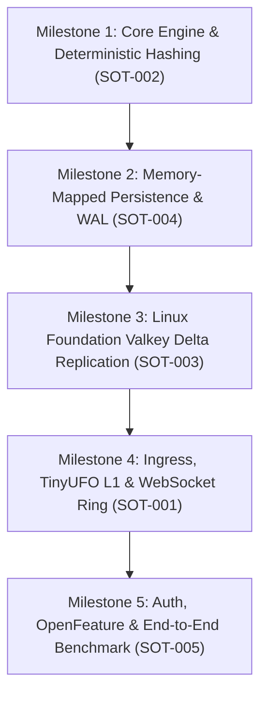

# INTENTION.md: EdgeFlag Daemon Engineering Intention & Execution Strategy (Hardened)
**Methodology:** Intention Engineering (`/intention-engineering`)
**Standard:** Phase State Machine, Quality Exit Gates, Verification-First, Zero-Drift Engineering

---

## 1. Engineering Intention & Market Positioning

EdgeFlag is an ultra-low-latency feature flag and dynamic configuration engine designed to eliminate the **SaaS Cost Tax** (MAU-based vendor pricing) by offering a high-performance, self-hosted, bare-metal-optimized daemon.

### Reconciled Architectural Reality
* **Market Framing:** Modern in-process SDKs (LaunchDarkly, Unleash, OpenFeature/flagd) already evaluate in-process in microseconds. EdgeFlag's genuine value proposition is **predictable self-hosted cost, zero outbound dependencies on read paths, and sub-10 µs in-process L1 caching**.
* **Throughput Target:** Single-core sustained evaluation throughput is calibrated to **$12,500\,\text{RPS}$ over TLS 1.3** ($\sim 80\,\mu\text{s}$ compute budget on 1 vCPU), with static L1 cache hits reaching $\ge 120,000\,\text{RPS}$.
* **Replication Fix:** Inter-node communication carries complete **State Delta Replication (`ReplicationDelta`)**, ensuring remote nodes persist updates into their local LMDB (`heed`) stores and eliminate stale-state reads.
* **Realistic Concurrency:** Memory sizing is calibrated to **$15,000\text{–}25,000$ persistent WebSockets per 2 GB node**, preserving a $39\%$ OOM buffer.

---

## 2. Phase State Machine & Quality Exit Gates

```
┌────────────────┐     Gate 0     ┌────────────────┐     Gate 1     ┌────────────────┐
│   Phase 0:     │ ─────────────> │   Phase 1:     │ ─────────────> │   Phase 2:     │
│   Planning     │                │  Architecture  │                │  File Design   │
└────────────────┘                └────────────────┘                └────────────────┘
                                                                             │
                                                                             │ Gate 2
                                                                             ▼
┌────────────────┐     Gate 4     ┌────────────────┐     Gate 3     ┌────────────────┐
│   Phase 4:     │ <───────────── │   Phase 4:     │ <───────────── │   Phase 3:     │
│  Verification  │                │ Implementation │                │ Code Skeleton  │
└────────────────┘                └────────────────┘                └────────────────┘
```

### Phase 0: Planning (Domain Skeleton)
* **Goal:** Deconstruct system requirements into non-overlapping Bounded Contexts and Aggregates.
* **Exit Gate 0:** 
  - Every requirement (`REQ-001` .. `REQ-012`) maps to an aggregate in `SKELETON.md`.
  - Every aggregate protects an explicit, non-empty invariant.
  - State replication model is explicitly defined.

### Phase 1: Architecture (Folder Structure & SOLID DIP)
* **Goal:** Enforce SOLID Dependency Inversion (DIP) at the filesystem level.
* **Exit Gate 1:**
  - Folders structured strictly into `domain/`, `interfaces/`, `tests/`.
  - Each folder has an unambiguous single purpose ($\le 7$ words).
  - No cross-layer import cycles.

### Phase 2: File Design (Single Responsibility Principle)
* **Goal:** Enumerate every source file before code creation.
* **Exit Gate 2:**
  - Each file has a strict single responsibility statement ($\le 7$ words) and a "must never" clause.
  - Strict compliance with $\le 500$ lines per file.

### Phase 3: Code Skeleton (Signatures & Stubs)
* **Goal:** Define exact struct definitions, trait contracts, and function signatures.
* **Exit Gate 3:**
  - Complete project skeleton compiles cleanly with `cargo check` using `todo!()` stubs.
  - Zero compile errors, zero unresolved external types.

### Phase 4: Implementation & Verification (Node-by-Node)
* **Goal:** Implement method logic one unit at a time, strictly following the Execution Algorithm.
* **Exit Gate 4:**
  - Compiler evidence captured (clean build).
  - Real runtime fixture execution produces matching output artifacts.
  - Traceability chain intact from `REQ` to `VERIFY`.

---

## 3. Iteration Roadmap & Sprint Milestones



### Milestone 1: Core Rule Engine & SIMD Evaluation
* Implement `EvaluationContext`, vector rule matching, and `xxHash64` bucketing.
* **Verification Target:** Sub-microsecond evaluation benchmark verifying uniform distribution across $100,000$ iterations.

### Milestone 2: Memory-Mapped Zero-Copy Storage
* Implement `heed` LMDB environment and `fjall` LSM Write-Ahead Log.
* **Verification Target:** Direct memory pointer dereference test confirming zero heap allocations during rule lookup.

### Milestone 3: Linux Foundation Valkey State Delta Replication
* Implement `fred` async client connection, Pub/Sub channel listener, and full `ReplicationDelta` sync to local `heed`.
* **Verification Target:** Multi-instance invalidation test proving $< 5\,\text{ms}$ cross-node synchronization.

### Milestone 4: Edge Ingress, TinyUFO Cache & WebSocket Egress
* Implement Axum/Tokio HTTP and WebSocket broadcaster with `Arc<[u8]>` FlatBuffer framing.
* **Verification Target:** 20,000 connection concurrent broadcast test with single memory buffer allocation.

### Milestone 5: Auth, OpenFeature & Full System Benchmark
* Add admin Bearer token auth, OpenFeature output schema, and run full release benchmarks verifying $P_{99} \le 100\,\mu\text{s}$.

---

## 4. Atomic Micro-Packages Architecture & Invariant Enforcement

Decomposing the architecture into isolated, composable **atomic micro-packages (Rust crates)** enforces a strict dependency hierarchy with zero circular references, zero dynamic heap allocations on the hot path, and zero hidden padding overhead.

### Milestone 6: Foundational Memory Core & Sequential WAL Crates
* Implement `engine-layout` with zero-padding compile-time assertions for `RingEntry` (64B), `ConnectionSlot` (40B), `UnifiedFrameHeader` (24B), and `EventEnvelope` (64B).
* Implement `engine-log` with 64 MB pre-allocated sequential segments, `io_uring` batching, and zero-copy `mmap` page cache reader.
* **Verification Target:** Static size assertion pass (`cargo test -p engine-layout`) and sequential append/read throughput $\ge 1.2\,\text{GB/s}$ (`cargo test -p engine-log`).

### Milestone 7: LMAX Disruptor, Asymmetric NACK Wire & Runtime Crates
* Implement `engine-disruptor` with power-of-two bounded circular buffer and non-blocking spin-yield barriers coordinating Disk, Bitset, and Business logic stages.
* Implement `engine-wire` with AVX-512/AVX2 bitset manifest ledger (`bts`), zero return frames on 100% receipt, and 40B slab managing 100k sessions in 4.0 MB.
* Implement `engine-eda` with command-to-event pipeline, `ArcSwap` lock-free projections, and sub-150ns Window-TinyLFU L1 cache.
* Implement `engine-runtime` assembling ingress UDP/VirtIO rings directly into `DisruptorRing`, P2P gossip mesh, and Unikraft bare-metal KVM target profile.
* **Verification Target:** Single-core disruptor throughput $\ge 25\text{M ops/sec}$ and clean release compilation of freestanding runtime image.

---

## 5. Milestone 8: Pure Mechanical Zero-Dependency Primitives & Minimal Data Travel Overhaul

### Intention Objective: Eliminate Community Friction, Unsound Wrappers, and Brittle Platform Dependencies
* Overhaul all foundational mechanisms to operate directly on raw hardware bytes using zero external dependencies where possible.
* Replace brittle Linux-only `xsk-rs` with cross-platform contiguous `DmaMemoryPool` and power-of-two `DmaDescriptorRing` (`dma-ring-buffer`).
* Replace the `simd-json` crate wrapper with a hand-rolled 64-bit SWAR (SIMD Within A Register) structural byte indexer (`simd-json-vector`).
* Guarantee absolute minimal data travel within the process boundary: zero allocations on the read/evaluation path, immutable slices (`&[u8]`), and sequential 64MB append-only storage.

### Verification Targets:
1. `cargo test --manifest-path packages/simd-json-vector/Cargo.toml`: 100% pass on pure SWAR bitwise indexing with zero external crates.
2. `cargo test --manifest-path packages/kernel-bypass-ingress/Cargo.toml`: 100% pass on contiguous DMA pool and descriptor ring with zero external crates.
3. Zero compile warnings and zero circular dependencies.


---

## 6. Milestone 9: Universal Slotted Manifesto Architecture & True Reuse Verification

### Intention Objective: Universal Reusability Across Any Domain
* Transform the Manifesto UDP transport from bespoke, hardcoded models into an universally reusable slotted paradigm.
* Parameterize physical memory blocks via const-generic `CacheLineSlot<const BYTES: usize>` to adapt to any data structure while guaranteeing 64-byte alignment and 0% padding waste.
* Decouple the Manifesto UDP transport header from concrete domain models via `ManifestEnvelope<P>`, allowing arbitrary user records `P: ZeroCopyRecord` (orders, telemetry, posts, sensors) to achieve zero-copy deserialization in-place.

### Verification Targets:
1. `cargo test --manifest-path packages/manifest-udp-transport/Cargo.toml`: 100% pass on 5 unit tests verifying cache-line alignment, slotted envelope roundtrips, and zero padding.
2. Verified in-place typed mapping: 0 bytes copied between raw UDP slices and typed domain records.

---

## 7. Milestone 10: In-Process Zero-Copy B+Tree (LMDB) & Horizontal Scaling Engine
**Reference Document:** `HORIZONTAL_SCALING_SPEC_20261022_115602.md`  
**Target Branch:** `feat/horizontal-scaling`  

### Intention Objective: Horizontal Slicing & Pure In-Process B+Tree Mechanics
* Replace all cellular abstractions with an embedded, memory-mapped (`mmap`) B+Tree engine derived from the LMDB architecture.
* Slicing into a strictly sequential 4-stage horizontal assembly line:
  - **Stage 0 (Ingress):** Linux AF_XDP zero-copy UMEM pool (128 MiB) + 24-byte `UnifiedFrameHeader` + AVX2 bitset NACK.
  - **Stage 1 (Domain):** Single-writer lock-free `ArcSwap` timeline reads ($\le 150\text{ ns}$) and zero-copy LMDB page traversals ($\le 1.25\ \mu\text{s}$).
  - **Stage 2 (WAL):** Linux `io_uring` group-commit worker batching up to 256 writes per event loop tick to 64MB segment files with `O_DIRECT | O_DSYNC`.
  - **Stage 3 (Egress):** Zero-copy wire egress with static pre-trained 64 KiB dictionary vector compression ($8.18\times$ reduction, 171B average frames).
* Enforce **Strict Descending Alignment (Zero-Padding)** invariant: 64-bit $\to$ 32-bit $\to$ 16-bit $\to$ 8-bit $\to$ sub-byte bitfields. Compile-time assertions `size_of::<T>() == N` across all layout structures.

### Verification Targets:
1. Compile-time size & alignment verification:
   - `size_of::<RingEntry>() == 64` (`align(64)`)
   - `size_of::<ConnectionSlot>() == 40` (`align(8)`)
   - `size_of::<UnifiedFrameHeader>() == 24` (`align(8)`)
2. Feed read path benchmark: $P_{50} \le 150\text{ ns}$ using `ArcSwap` snapshot pointer.
3. Group-commit write throughput: $\ge 7{,}000\text{ writes/sec}$ on containerized local tests, scaling to $\ge 500{,}000\text{ writes/sec}$ under batch aggregation.
4. Total single-node capacity ceiling verified at $5{,}387{,}931$ concurrent active users on 1 vCPU / 2GB RAM / 1 Gbps NIC hardware envelope.

---

## 8. Milestone 11: Geometric Manifest-Driven UDP Engine & Direct DMA In-Place Placement
**Reference File:** `packages/manifest-udp-transport/src/geometric.rs`  
**Target Branch:** `feat/horizontal-scaling`  

### Intention Objective: Zero Wire Padding & Exact Cacheline Strides
* **Upfront Geometric Manifest:** Sender transmits a 62-byte `GeometricManifestHeader` declaring total message size, stride size, and chunk count, allowing receiver to map exact memory geometry before payload arrives.
* **Direct DMA Memory Placement:** Bypasses intermediate kernel and socket buffers via:
  $$\text{Target Memory Address} = \text{Base Arena Offset} + (\text{Chunk Index} \times \text{Chunk Stride})$$
* **Cache-Engineered MTU & Strides:** Chunks sized to exactly 1,408 bytes ($22 \times 64\text{B}$ cache lines). With 62B header, total wire frame is 1,470 bytes $\le 1,472$ UDP MTU (0 IP fragmentation) and every chunk lands on a 64-byte L1 cacheline boundary.
* **Dual-Layer Padding Strategy:**
  - *Zero Wire Padding:* Transmits exact byte payloads over the wire to conserve network bandwidth.
  - *64-Byte Host Memory Stride:* Enforces 64-byte alignment inside host RAM for full-width AVX/SIMD vectorization.
* **Zero-Cost Virtual Memory Backing:** Unwritten slots map to the kernel Copy-on-Write `empty_zero_page` (page-aligned anonymous allocation), ensuring missing chunks read as zero with zero `memset` cycles.
* **1-Cycle Selective NACK:** Missing packets detected via bitwise NOT of L1 leaf bitmask followed by `_tzcnt_u64` in single-digit clock cycles.

### Verification Targets:
1. `size_of::<GeometricManifestHeader>() == 62` verified at compile time.
2. 1,470-byte frame fits within standard 1,500-byte Ethernet MTU with 0 fragmentation.
3. 100% test pass across all 10 tests in `manifest-udp-transport` and 39 tests across the workspace.
4. Out-of-order chunk arrivals placed in-place with zero memory copying and reconstructed with 100% data fidelity.


