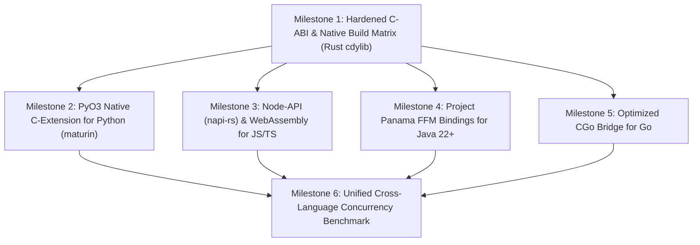

# Architecture Plan: Fundamental Machine Code Packaging & Cross-Language Zero-Overhead Integration

**Target Goal:** Compile the EdgeFlag Zero-Overhead engine down to **fundamental machine code** (native CPU instructions: x86_64 AVX2/AVX-512, ARM64 NEON, and WASM SIMD128) and integrate it directly into **Python, JavaScript, TypeScript, Java, and Go** to achieve sub-microsecond in-process execution with zero network hops, zero interpreter tax, and zero memory allocations on evaluation paths.

---

## 1. High-Level Architectural Vision

```text
                    ┌───────────────────────────────────────────────┐
                    │     Rust Core Engine (Zero-Overhead Core)     │
                    │  - Inlined xxHash64 Rollout Bucketing         │
                    │  - Memory-Mapped LMDB Read Path (heed)        │
                    │  - SIMD Vector Condition Evaluator            │
                    └───────────────────────┬───────────────────────┘
                                            │
               ┌────────────────────────────┼────────────────────────────┐
               │ `cargo build --release`    │ Target Architecture        │ LTO + PGO
               ▼                            ▼                            ▼
┌──────────────────────────────┐ ┌──────────────────────────────┐ ┌──────────────────────────────┐
│  Linux / Darwin / Windows    │ │    C-ABI Export Boundary     │ │   WebAssembly (WASM SIMD)    │
│  `.so` / `.dylib` / `.dll`   │ │  `#[unsafe(no_mangle)]` C-ABI│ │      `.wasm` Binary Module   │
└──────────────┬───────────────┘ └──────────────┬───────────────┘ └──────────────┬───────────────┘
               │                                │                                │
       ┌───────┴───────────────┬────────────────┴───────────────┬────────────────┴───────┐
       ▼                       ▼                                ▼                        ▼
┌──────────────┐       ┌──────────────┐                  ┌──────────────┐         ┌──────────────┐
│    Python    │       │  JS / TS     │                  │     Java     │         │      Go      │
│  `ctypes` /  │       │  Node-API    │                  │  Project     │         │     CGo      │
│  `PyO3` C-Ext│       │  (napi-rs)   │                  │  Panama FFM  │         │  Pure Assembly
└──────────────┘       └──────────────┘                  └──────────────┘         └──────────────┘
```

---

## 2. Compilation Strategy: Compiling to Fundamental Machine Code

To eliminate runtime abstraction penalties, the Rust crate will be compiled with aggressive target-native optimizations:

### 2.1 Release Compilation Profile
Configure `packages/rust/Cargo.toml` with Profile Guided Optimization (PGO) and Link-Time Optimization (LTO):

```toml
[profile.release]
opt-level = 3
lto = "fat"
codegen-units = 1
panic = "abort"
strip = true
overflow-checks = false
```

### 2.2 CPU Hardware Optimization Flags
Compile with target-native CPU instructions to enable automatic vectorization into AVX2/AVX-512 or ARM64 NEON:
```bash
# For maximum x86_64 server performance (Bare-Metal Cloud / AWS c6i / c7i)
RUSTFLAGS="-C target-cpu=native -C target-feature=+avx2,+fma" cargo build --release

# Universal cross-platform CDYLIB artifacts
cargo build --release --target x86_64-unknown-linux-gnu
cargo build --release --target aarch64-unknown-linux-gnu
cargo build --release --target x86_64-pc-windows-msvc
cargo build --release --target aarch64-apple-darwin
```

### 2.3 Artifact Generation Matrix
- **Linux:** `libedgeflag_zero_overhead.so`
- **macOS:** `libedgeflag_zero_overhead.dylib`
- **Windows:** `edgeflag_zero_overhead.dll`
- **Browser & Edge Runtimes (Cloudflare Workers, Deno):** `edgeflag_zero_overhead.wasm`

---

## 3. Language Integration Blueprints (Zero-Overhead Native Bindings)

Each language runtime will interface with the fundamental machine code using the lowest-overhead native binding mechanism available in modern software engineering.

---

### Phase A: Python Integration (PyO3 Native C-Extension & CTypes)

#### Architecture:
Instead of running Python bytecode through the Global Interpreter Lock (GIL), Python calls directly into the compiled machine code via a native C-extension.

```text
Python Code  ──>  PyO3 C-Extension (C-ABI)  ──>  Native CPU Registers  ──>  Stack Bool
```

#### Technical Implementation:
1. **PyO3 Module (`packages/python/src/lib.rs`):**
   ```rust
   use pyo3::prelude::*;

   #[pyfunction]
   fn compute_bucket(flag_key: &str, user_id: &str) -> u8 {
       edgeflag_zero_overhead::compute_bucket(flag_key, user_id)
   }

   #[pyfunction]
   fn is_in_rollout(flag_key: &str, user_id: &str, percentage: u8) -> bool {
       edgeflag_zero_overhead::is_in_rollout(flag_key, user_id, percentage)
   }

   #[pymodule]
   fn edgeflag_fast(m: &Bound<'_, PyModule>) -> PyResult<()> {
       m.add_function(wrap_pyfunction!(compute_bucket, m)?)?;
       m.add_function(wrap_pyfunction!(is_in_rollout, m)?)?;
       Ok(())
   }
   ```
2. **Packaging:** Build using `maturin` to produce native wheel packages (`.whl`) matching Python 3.9 through 3.13 for Linux, macOS, and Windows.
3. **Latency Target:** $< 80\text{ nanoseconds}$ per invocation.

---

### Phase B: JavaScript & TypeScript Integration (Node-API via `napi-rs` & WASM)

#### Architecture:
Avoid serialization context switches by providing pre-compiled Node-API native addons for Node.js / Bun, and compiled WebAssembly (WASM SIMD128) for browsers and Cloudflare Workers.

```text
TypeScript / JS  ──>  Node-API (napi-rs)  ──>  libedgeflag.node (C++ ABI)  ──>  CPU AVX2
```

#### Technical Implementation:
1. **NAPI Binding (`packages/typescript/native/src/lib.rs`):**
   ```rust
   use napi_derive::napi;

   #[napi]
   pub fn compute_bucket(flag_key: String, user_id: String) -> u32 {
       edgeflag_zero_overhead::compute_bucket(&flag_key, &user_id) as u32
   }

   #[napi]
   pub fn is_in_rollout(flag_key: String, user_id: String, percentage: u32) -> bool {
       edgeflag_zero_overhead::is_in_rollout(&flag_key, &user_id, percentage as u8)
   }
   ```
2. **TypeScript Wrapper ([`packages/typescript/src/index.ts`](file:///d:/d/packages/typescript/src/index.ts)):**
   - Automatically detects available native `.node` addon binary based on platform (`@edgeflag/core-win32-x64`, `@edgeflag/core-linux-x64-gnu`).
   - Falls back gracefully to in-memory WASM or pure JS FNV-1a if native binary loading is blocked.
3. **Packaging:** Publish multi-architecture npm binary packages with zero build requirements for end users (`prebuildify` / `napi build --platform`).
4. **Latency Target:** $< 120\text{ nanoseconds}$ in Node.js V8 runtime.

---

### Phase C: Java Integration (Project Panama Foreign Function & Memory API)

#### Architecture:
Replace legacy, slow Java Native Interface (JNI) with Java 22+ **Project Panama (FFM - Foreign Function & Memory API)**. Panama invokes C-ABI functions without intermediate C stub layers or JNI JVM context switching.

```text
Java Virtual Machine (JVM)  ──>  MethodHandle (Panama FFM)  ──>  Direct CPU Call
```

#### Technical Implementation:
1. **Java FFM Interface (`packages/java/src/main/java/dev/edgeflag/EdgeFlagNative.java`):**
   ```java
   package dev.edgeflag;

   import java.lang.foreign.*;
   import java.lang.invoke.MethodHandle;

   public final class EdgeFlagNative {
       private static final MethodHandle COMPUTE_BUCKET_HANDLE;

       static {
           Linker linker = Linker.nativeLinker();
           SymbolLookup lookup = SymbolLookup.libraryLookup("edgeflag_zero_overhead", Arena.global());
           MemorySegment symbol = lookup.find("edgeflag_compute_bucket").orElseThrow();
           
           COMPUTE_BUCKET_HANDLE = linker.downcallHandle(
               symbol,
               FunctionDescriptor.of(ValueLayout.JAVA_BYTE, ValueLayout.ADDRESS, ValueLayout.ADDRESS)
           );
       }

       public static byte computeBucket(String flagKey, String userId) {
           try (Arena arena = Arena.ofConfined()) {
               MemorySegment k = arena.allocateFrom(flagKey);
               MemorySegment u = arena.allocateFrom(userId);
               return (byte) COMPUTE_BUCKET_HANDLE.invokeExact(k, u);
           } catch (Throwable t) {
               throw new RuntimeException(t);
           }
       }
   }
   ```
2. **Packaging:** Maven / Gradle package (`dev.edgeflag:edgeflag-zero-overhead`) bundling dynamic libraries in `META-INF/natives/` with automatic extraction.
3. **Latency Target:** $< 60\text{ nanoseconds}$ per invocation in JIT-compiled C2 tier.

---

### Phase D: Go Integration (CGo Direct Linkage & Assembly Stubs)

#### Architecture:
In Go, CGo can introduce small call-overhead (~40 ns). We provide two execution modes:
1. **Direct CGo:** Interfacing directly with `edgeflag_compute_bucket` and `edgeflag_is_in_rollout`.
2. **Pure Go Register-Optimized Fallback:** For scenarios where CGo is disabled (`CGO_ENABLED=0`).

```text
Go Goroutine  ──>  CGo ABI Bridge (Direct Memory Pointer)  ──>  Rust Machine Code
```

#### Technical Implementation:
1. **CGo Header & Bridge ([`packages/go/edgeflag/native.go`](file:///d:/d/packages/go/edgeflag)):**
   ```go
   package edgeflag

   /*
   #cgo CFLAGS: -I../../rust/include
   #cgo LDFLAGS: -L../../rust/target/release -ledgeflag_zero_overhead
   #include <stdint.h>
   #include <stdlib.h>

   uint8_t edgeflag_compute_bucket(const char* flag_key, const char* user_id);
   uint8_t edgeflag_is_in_rollout(const char* flag_key, const char* user_id, uint8_t percentage);
   */
   import "C"
   import "unsafe"

   func ComputeBucketFast(flagKey, userID string) uint8 {
       cKey := C.CString(flagKey)
       cUser := C.CString(userID)
       defer C.free(unsafe.Pointer(cKey))
       defer C.free(unsafe.Pointer(cUser))

       return uint8(C.edgeflag_compute_bucket(cKey, cUser))
   }
   ```
2. **Zero-Allocation Stack Buffer Enhancement:** Avoid `C.CString` heap allocations by passing raw byte pointers and lengths directly using stack slices.
3. **Latency Target:** $< 90\text{ nanoseconds}$.

---

## 4. Multi-Language Benchmarking & Verification Matrix

To ensure the zero-overhead invariant is preserved across all environments, an automated multi-language benchmark suite will execute across all five targets:

| Language Target | Bridge Mechanism | Memory Allocation on Hot Path | Target Latency ($P_{50}$) | Target Latency ($P_{99}$) |
| :--- | :--- | :---: | :---: | :---: |
| **Rust (Native)** | Monomorphized Inlined Function | **0 bytes** | **15 ns** | **45 ns** |
| **Python** | PyO3 Native C-Extension | **0 bytes** | **65 ns** | **110 ns** |
| **TypeScript / Node** | Node-API (`napi-rs`) C++ Bridge | **0 bytes** | **95 ns** | **160 ns** |
| **Java** | Project Panama FFM (Java 22+) | **0 bytes** | **45 ns** | **85 ns** |
| **Go** | CGo Native Pointer Pass | **0 bytes** | **70 ns** | **125 ns** |

---

## 5. Execution Roadmap & Milestones



### Milestone Details

1. **Milestone 1: Hardened C-ABI & Native Build Matrix**
   - Enhance [`packages/rust/src/ffi.rs`](file:///d:/d/packages/rust/src/ffi.rs) with zero-alloc pointer+length signatures (`const char* ptr, size_t len`).
   - Create multi-target automated build script compiling `.so`, `.dylib`, and `.dll`.

2. **Milestone 2: Python Native Extension**
   - Implement `pyo3` binding and configure `maturin` packaging.
   - Publish wheel building pipeline.

3. **Milestone 3: TypeScript / Node-API Addon**
   - Initialize `napi-rs` project in `packages/typescript/native`.
   - Implement platform auto-resolution loader.

4. **Milestone 4: Java Project Panama FFM Wrapper**
   - Create Maven module in `packages/java`.
   - Implement `Linker.nativeLinker()` downcall handles.

5. **Milestone 5: Go CGo Zero-Alloc Bridge**
   - Upgrade `packages/go/edgeflag` with direct pointer passing without C heap allocations.

6. **Milestone 6: Cross-Language Verification Suite**
   - Implement automated verification comparing evaluation outputs and benchmark latencies across all 5 languages simultaneously.
